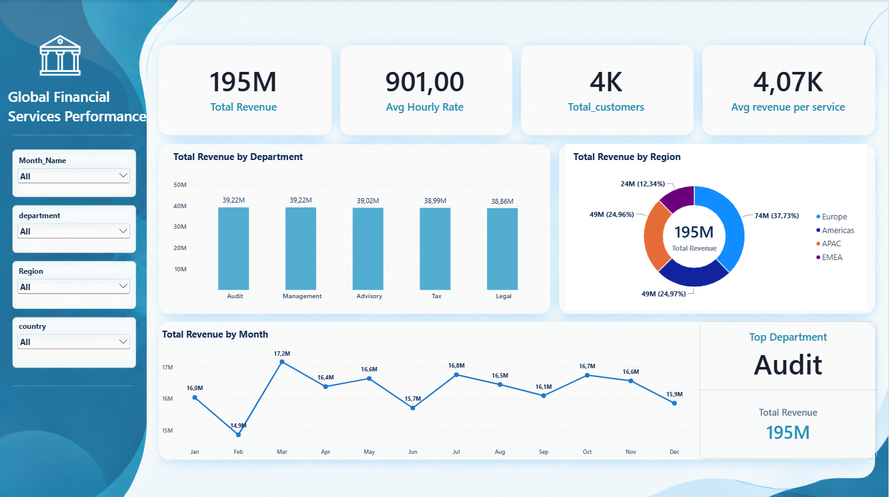

# Financial Services Performance Analytics | Power BI

**Power BI · DAX · Financial Analytics · What-If Analysis · Data Visualization**

## Project Overview

This project presents an interactive Power BI dashboard designed to analyze financial services revenue across departments, regions, and months.

The report combines financial performance monitoring with a What-If simulation to evaluate how changes in hourly billing rates could affect revenue.

## Business Objectives

- Monitor overall financial services revenue.
- Compare revenue across departments and regions.
- Identify monthly revenue trends.
- Evaluate the potential impact of hourly rate adjustments.
- Support data-driven pricing and revenue planning.

## Key Performance Indicators

| KPI | Value |
|---|---|
| Total Revenue | 195M |
| Average Hourly Rate | 901.00 |
| Total Customers | 4K |
| Average Revenue per Service | 4.07K |
| Departments | 5 |
| Regions | 4 |

## Key Business Insights

### 1. Department Performance

Audit and Management each generated 39.22M in revenue, based on the displayed rounded values.

Revenue was relatively balanced across the five departments, ranging from 38.86M to 39.22M.

### 2. Regional Performance

Europe was the leading region, contributing 37.73% of total revenue.

Americas and APAC each contributed approximately 25%, while EMEA accounted for 12.34%.

### 3. Monthly Revenue Trends

March recorded the highest displayed monthly revenue at 17.2M, while February recorded the lowest at 14.9M.

## What-If Analysis: Hourly Rate Adjustment

The dashboard includes an interactive What-If simulation to estimate the financial impact of changes in hourly billing rates.

**Scenario:**
- Hourly rate increase: +4%
- Baseline revenue: 195M
- Projected revenue: 203M
- Projected revenue impact: +7.8M
- Projected revenue growth: +4.0%

The simulation assumes that total service hours remain constant.

These results are hypothetical projections, not realized revenue gains.

## Dashboard Screenshots

### Financial Performance Overview

### What-If Hourly Rate Simulation

## Data Source & SQL Server Integration

Connected Power BI to a SQL Server database using a SQL View as the reporting data source.

This approach enabled financial analysis without modifying the underlying raw data tables.

## Tools & Skills

- SQL Server (SQL Views)
- Power BI
- DAX
- SQL Server to Power BI Data Integration
- Financial KPI Analysis
- What-If Scenario Modeling
- Data Visualization

## Business Recommendations

- Monitor revenue distribution across departments to identify performance changes.
- Analyze the factors driving Europe's leading revenue contribution.
- Investigate monthly revenue fluctuations to support financial planning.
- Evaluate pricing scenarios alongside customer demand and service capacity before making pricing decisions.

## 🎥 Dashboard Demo

Watch the Financial Services Analytics dashboard demonstration, including revenue analysis, regional performance, and the interactive What-If hourly rate simulation.

**[▶ Watch the full dashboard demonstration on YouTube](https://youtu.be/xV_Pewoa1F8)**

